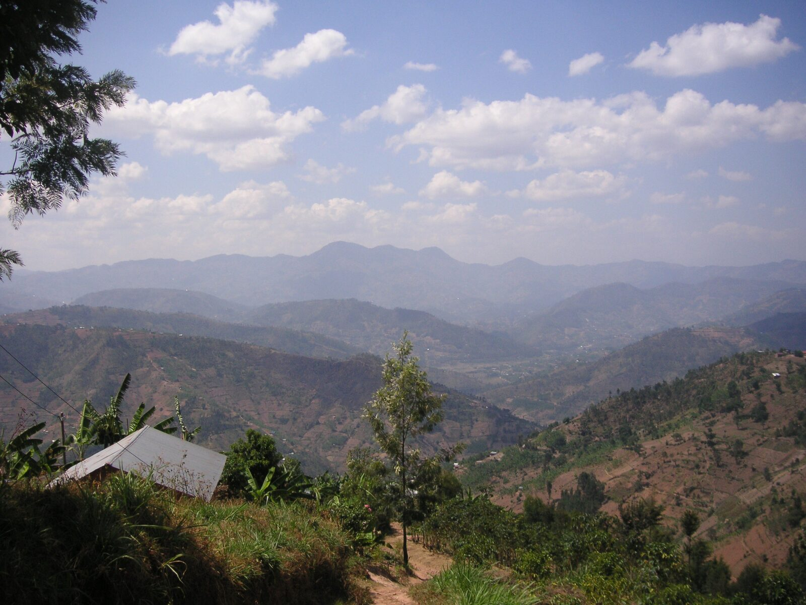

# Contributing to equinox-icl.github.io

This is the website for **e.quinox**, Imperial College London's student
humanitarian society. It's a static site served from GitHub Pages. No
build step, no framework — HTML + CSS + vanilla JS.

Every part of the site is editable with a text editor. The sections below
explain where things live so a committee handover in any year takes 20
minutes instead of a term.

## Quick start

```bash
# Option A: any static server
npx live-server --port=8765 --no-browser

# Option B: Python
python3 -m http.server 8765
```

Then open <http://localhost:8765/>.

## Files

```
/
├── index.html           Homepage (long-scroll: hero → manifesto → 15-year arc
│                        → featured → stats → bento → CTA)
├── about.html           Team, how we work, governance
├── projects.html        Stacked long-read archive, rendered from projects.json
├── connect.html         Narrative + form split
├── static/
│   ├── auxcss/
│   │   ├── helper.css   Design tokens, global a11y, shared utilities
│   │   └── header.css   Header partial styles
│   ├── auxhtml/
│   │   ├── header.html  Shared header injected via include.js
│   │   └── font.html    (Deprecated — kept only if linked from legacy pages)
│   ├── css/             One stylesheet per page
│   ├── js/
│   │   ├── include.js   Async partial includes via data-include-html
│   │   ├── togglemenu.js  aria-current on the active nav link
│   │   ├── generateProjects.js  Renders projects.json into chapters
│   │   └── scroll.js    Reveal, counter, arc, wire, spotlight
│   ├── images/          Photos + logos. Derivatives generated by the
│   │                    optimize-images.sh script (see below).
│   └── json/
│       └── projects.json  Project archive data
└── scripts/
    └── optimize-images.sh  Image pipeline
```

## Design tokens

All colour, spacing, radius, type and motion values live in
`static/auxcss/helper.css` under `:root`. To retheme, change them there:

```css
:root {
    --green: #0b2600;       /* page background */
    --yellow: #ffcf6d;      /* ink + accent */
    --rust: #c65200;        /* links, rails, rest-state accents */
    --darkrust: #963200;    /* reserved, low-priority */
    /* spacing: --space-1..5 (8 / 16 / 24 / 48 / 96 px) */
    /* radius:  --radius-sm / --radius / --radius-lg */
    /* motion:  --ease-warm, --dur-warm (240ms), --dur-slow (480ms) */
}
```

Utility classes (`.yellow`, `.greenbg`, `.rust`, `.rustbg`, `.font20`, …)
remain as aliases mapping to the tokens — safe to keep using on existing
markup; prefer tokens in new CSS.

## Typography

Body/UI: **Poppins** (300/400/500/600). Display: **Fraunces**
(variable, 300/400 weights). Loaded from Google Fonts in every HTML
`<head>`. If you self-host in future, drop the `<link>` to fonts.googleapis
and add `@font-face` rules in `helper.css`.

## Images

The `scripts/optimize-images.sh` script generates WebP + JPEG derivatives
for every photo in `static/images/`:

```bash
brew install webp imagemagick      # once
./scripts/optimize-images.sh       # regenerate all
./scripts/optimize-images.sh landing.jpg   # one file
```

Output filename convention: `<stem>-<width>w.{webp,jpg}`. The script is
idempotent and only rebuilds outputs older than the source. Target
widths are 800 / 1600 / 2400; for images smaller than 800w, the script
emits a single derivative at the source width.

Use derivatives via `<picture>`:

```html
<picture>
  <source type="image/webp"
          srcset="static/images/landing-800w.webp 800w,
                  static/images/landing-1600w.webp 1600w"
          sizes="(max-width: 900px) 100vw, 50vw">
  
</picture>
```

The LCP image (homepage hero) gets `fetchpriority="high"` and a `<link
rel="preload" as="image">` in the head.

## Editing content

### Hero copy

`index.html`, section `<!-- A · HERO -->`. Three `<span class="hero__line">`
elements make up the tagline. The eyebrow (`Student-led · Engineer-built ·
Community-owned`) sits right below.

### Impact stats

`index.html`, `<!-- E · IMPACT STATS BAND -->`. Each `<li class="stats__cell">`
has a `data-count-to="N"` attribute that controls the number shown. The
counter animates from 0 to N once the section enters the viewport.

### Projects archive

`static/json/projects.json`. Each entry:

```json
{
  "title": "Rainwater Recon",
  "year": 2024,
  "tag": "From electricity to water",
  "imageStem": "static/images/2024",
  "imageWidths": [800, 1600],
  "imageAlt": "Rainwater harvesting installation, Rwanda",
  "description":  "First paragraph…",
  "description2": "Second paragraph…",
  "outcomes": ["Bullet 1", "Bullet 2", "Bullet 3"]
}
```

1. Drop the photo into `static/images/` (e.g. `static/images/2026.jpg`).
2. Run `./scripts/optimize-images.sh 2026.jpg` to generate derivatives.
3. Add a new object to `projects.json` pointing `imageStem` to
   `static/images/2026` with the matching `imageWidths`.
4. `generateProjects.js` picks it up automatically; no code edits.

### Social links

`static/auxhtml/header.html` — two `<a class="header__social">` elements.
Change the `href="#"` placeholders to the real Instagram and LinkedIn
URLs when the handles are confirmed.

### Connect form

`connect.html`. The form POSTs to StaticForms.xyz; the access key is the
`accessKey` hidden input. If you rotate that key, update the hidden
input in place.

## Interactions

- **Spotlight cursor** (`data-spotlight` attribute on a section). Scoped
  to hero and bento. Automatically disabled on touch devices (runs a slow
  drift instead) and on `prefers-reduced-motion: reduce`.
- **Scrollytelling 15-year arc** (section `.arc`). Three slides inside a
  sticky stage; `scroll.js` toggles `.is-active`. To add a fourth slide,
  duplicate an `.arc__slide` block and increase the arc's `height` from
  `300vh` to `400vh`.
- **SVG wire thread** (`.wire`). Draws as the page scrolls; glows briefly
  at `#arc`, `#impact`, and `#join` waypoints. To change the path, edit
  the `<path d="…">` in `index.html`.
- **Filament-warm hovers** — unified across the site: `var(--rust)` →
  `var(--yellow)` with a soft glow over `var(--dur-warm)`. The pattern
  lives in each page's stylesheet; reuse it for new components.

## Deploy

Push to `main`. GitHub Pages serves the repository root.

## Style guardrails

- Two typefaces, two weights each. Don't add more.
- The only warm colour is golden yellow (`--yellow`). No neon, no cyan,
  no purple glow.
- Animate at most two elements at once per viewport.
- Wrap any new scroll/hover animation in
  `@media (prefers-reduced-motion: no-preference)` (or rely on the
  global reduced-motion kill in `helper.css`).
- Caption every photo with location + year in `<figcaption
  class="caption">`.
- Preserve the 96 px minimum vertical rhythm between sections
  (`--space-5`).

## Things the committee still needs to supply

- Real social media handles (replace `href="#"` in `header.html`).
- A real donation URL (replace `href="connect.html#donate"` in
  `index.html` CTA block).
- Confirmed impact numbers for the stats band (currently placeholder
  values in `data-count-to`).
- Committee photos and bios for the `<!-- Committee / team -->` section
  in `about.html`.
- Updated hero-copy if the team wants a different tagline than
  "Fifteen years bringing light to rural Rwanda."
